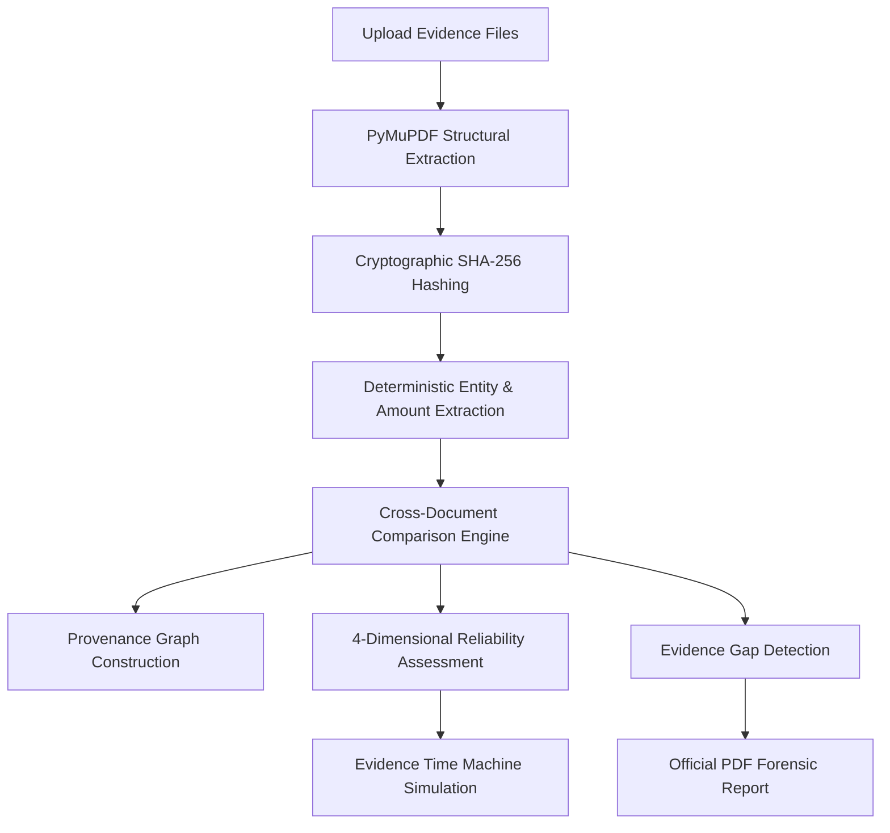

# TrustTrace AI — Digital Evidence Verification Platform

> **Beyond Fake Detection. Understand the Entire Evidence Story.**

TrustTrace AI is a digital forensics and evidence verification platform designed to analyze multi-document collections, uncover hidden relationships, identify inconsistencies, construct interactive provenance graphs, and pinpoint critical evidentiary gaps.

---

## Key Capabilities

- **Multi-Document Relationship & Inconsistency Analysis**: Deterministically cross-references financial amounts, transaction IDs, issuing entities, and dates across heterogeneous evidence files to discover discrepancies and unverified dependencies.
- **Deep PDF Structural Inspection**: Uses PyMuPDF to extract rendering engines, producer tags, creation/modification timestamps, font stream counts, raster image layouts, and metadata completeness scores.
- **Interactive Provenance Graphs**: Builds directed knowledge graphs using NetworkX and renders them interactively with `@xyflow/react`, mapping relationships between claims, documents, extracted facts, sources, and forensic findings.
- **4-Dimensional Reliability Assessment**: Replaces naive binary "real vs fake" labels with nuanced forensic dimensions:
  1. *Consistency* (timeline and numerical concordance)
  2. *Source Independence* (detecting single-source dependencies and circular corroboration)
  3. *Authenticity Verification* (structural digital integrity and rasterized screenshot detection)
  4. *Evidence Completeness* (identifying missing banking settlement records, third-party ledger entries, etc.)
- **Evidence Time Machine (Counterfactual Simulation)**: Non-destructively test what happens to the overall claim reliability and provenance network when a specific document is excluded from the evidentiary chain.
- **Incremental Version Comparison**: Snapshot and diff consecutive analysis cycles after new evidence is introduced.
- **Official Forensic PDF Reports**: Generates formal, publication-ready audit reports using ReportLab with complete provenance summaries and actionable recommendations.
- **Interactive Demonstration Case**: Pre-seeded with a fictional *Hospital Reimbursement Review* case (`inv-demo-hospital-reimbursement`) featuring generated bills, receipts, email confirmations, and bank statements.

---

## Architecture & Tech Stack

```
TrustTraceAI/
├── backend/                  # FastAPI REST Service & Forensic Analytics Engine
│   ├── app/
│   │   ├── config.py         # Environment configuration
│   │   ├── main.py           # Application entrypoint & lifespan
│   │   ├── models/schemas.py # Pydantic data schemas
│   │   ├── routers/api.py    # REST API endpoints
│   │   └── services/         # Core forensic algorithms
│   │       ├── comparison.py       # Cross-document comparison
│   │       ├── demo_case.py        # Demo dataset generator
│   │       ├── extractor.py        # Regex structured field extraction
│   │       ├── gap_finder.py       # 4D reliability & gap detection
│   │       ├── graph_builder.py    # NetworkX provenance graph construction
│   │       ├── llm_service.py      # LLM narrative synthesis fallback
│   │       ├── pdf_analyzer.py     # PyMuPDF structural parsing
│   │       ├── report_generator.py # ReportLab PDF report generation
│   │       ├── storage.py          # MongoDB / JSON storage repository
│   │       ├── time_machine.py     # Counterfactual simulation engine
│   │       └── versioning.py       # Version snapshot & comparison
│   ├── data/                 # Local persistent storage (store.json)
│   ├── uploads/              # Uploaded evidence documents & demo files
│   ├── run.py                # Server launcher script
│   └── requirements.txt      # Python dependencies
│
└── frontend/                 # Single Page Application
    ├── src/
    │   ├── components/       # Header, Sidebar, Badge, Modals
    │   ├── context/          # InvestigationContext state manager
    │   ├── pages/            # 10 specialized forensic views
    │   │   ├── Overview.tsx           # Dashboard & case metrics
    │   │   ├── Investigations.tsx     # Investigation listing & management
    │   │   ├── UploadEvidence.tsx     # Evidence ingestion queue
    │   │   ├── EvidenceAnalysis.tsx   # Cross-document findings & 4D review
    │   │   ├── ProvenanceGraph.tsx    # Interactive React Flow graph
    │   │   ├── EvidenceTimeMachine.tsx# Non-destructive exclusion simulator
    │   │   ├── VersionCompare.tsx     # Incremental analysis version comparison
    │   │   ├── DocumentDetail.tsx     # PyMuPDF internals & metadata editor
    │   │   ├── Reports.tsx            # Report preview & PDF export
    │   │   └── Settings.tsx           # Reviewer settings & privacy
    │   ├── services/api.ts   # Backend API client
    │   └── types/index.ts    # TypeScript interfaces
    ├── package.json
    └── vite.config.ts
```

### Core Technologies

- **Backend**: Python 3.12, FastAPI, PyMuPDF (fitz), NetworkX, ReportLab, Pydantic v2, PyMongo, Uvicorn.
- **Frontend**: React 19, TypeScript, Vite, Tailwind CSS v4, `@xyflow/react` (React Flow), Lucide React, React Router v7.

---

## Getting Started

### Prerequisites

- **Python**: 3.10+ (recommended 3.12)
- **Node.js**: 18+ (recommended 20+)
- **npm** or **pnpm** / **yarn**

---

### 1. Backend Setup

1. Open a terminal and navigate to the `backend/` directory:
   ```bash
   cd backend
   ```

2. Create and activate a virtual environment (optional but recommended):
   ```bash
   python -m venv .venv
   # Windows PowerShell:
   .venv\Scripts\Activate.ps1
   # Linux/macOS:
   source .venv/bin/activate
   ```

3. Install backend dependencies:
   ```bash
   pip install -r requirements.txt
   ```

4. Configure environment variables (optional):
   ```bash
   cp .env.example .env
   ```
   *(By default, local JSON storage is active, so MongoDB is optional)*

5. Run the backend server:
   ```bash
   python run.py
   ```
   Backend API will run at **http://127.0.0.1:8000** (Swagger documentation available at `/docs`).

---

### 2. Frontend Setup

1. Open a second terminal and navigate to the `frontend/` directory:
   ```bash
   cd frontend
   ```

2. Install dependencies:
   ```bash
   npm install
   ```

3. Start the Vite development server:
   ```bash
   npm run dev
   ```
   Open **http://localhost:5173** in your browser.

---

## Verification Pipeline



---

## License

MIT License. Designed for forensic document analysts, fraud examiners, compliance officers, and legal teams.
